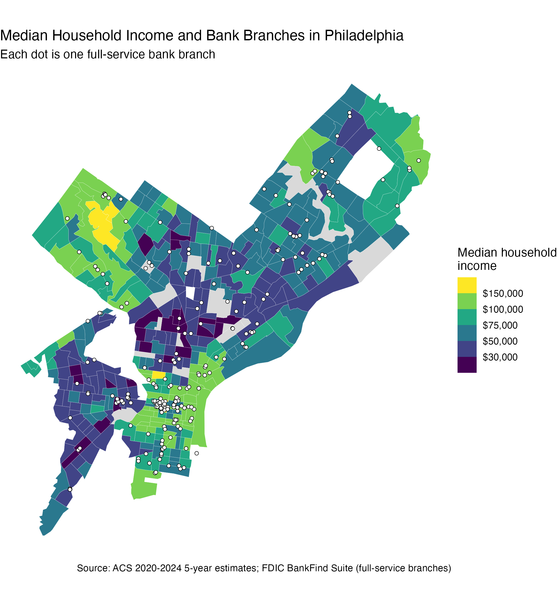
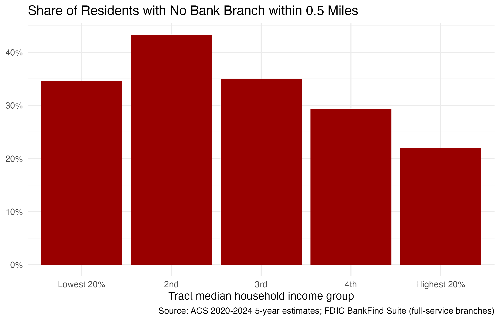

When I first moved to Philadelphia, opening a bank account was easy. Around Penn and Center City, there is a bank on almost every corner, and I could walk to one in five minutes. This made me curious about the rest of the city. Does every neighborhood have a bank this close?

The question matters more than it may seem. A bank branch is where people open accounts, deposit checks and talk to someone in person about a loan. Many people still need these services, especially older residents and people who do not use mobile banking. When the nearest bank is far away, some families turn to check cashing stores or payday lenders. These places are easy to find, but their fees are much higher, so living far from a bank can quietly cost a family money every month.

To answer the question, I combine two public datasets. The first is the FDIC BankFind Suite, which lists the location of every office of an FDIC-insured bank. I keep only full-service branches, which gives 239 branches in Philadelphia. The second is the American Community Survey (2020–2024), which gives the median household income, population and car ownership of each census tract. A census tract is a small neighborhood of about 4,000 people, and Philadelphia has 391 tracts with residents. For each tract, I measure the straight-line distance from its center to the nearest branch. If there is no branch within half a mile, which is about a ten-minute walk, I call the tract a "bank desert."

{width=100%}

The map shows the median household income of each tract, and each white dot is a bank branch. The dots crowd together in Center City, where incomes are high. Moving north into North Philadelphia, the tracts turn dark purple, which means lower income, and the dots become much more spread out. West and Southwest Philadelphia also have lower incomes and fewer dots.

To put numbers on this pattern, I split the tracts into five equal groups by income. The three lower income groups have about 980,000 residents and 100 bank branches in total. The two higher income groups have about 560,000 residents and 132 branches. Per person, the richest group has about 2.9 branches for every 10,000 residents, and the three lower groups have only about 1.0. That is almost three times as many branches per resident.

The interactive map below shows how far each tract is from its nearest branch. Darker red means a longer trip. Type a ZIP code in the search box, for example 19104, and the map will zoom in to that neighborhood. Move your mouse over a tract to see its income, the share of households without a car and the name of the closest bank.

<iframe src="images/fig2_zip_map.html" width="100%" height="650" style="border:none;"></iframe>

Overall, about one in three Philadelphians lives in a bank desert. The figure below shows how this share changes with income. The highest income group has the lowest share, at 22%. The second income group has the highest share, at 43%. The lowest income group is at 35%, about the same as the middle group. One possible reason is location. Several of the poorest tracts sit along busy commercial streets such as Broad Street, or close to Center City, and these areas have more branches nearby. So the poorest neighborhoods have few branches for their population, but many of their residents can still walk to one.

{width=100%}

Distance matters more for families without a car. In a typical tract in the lowest income group, about 44% of households do not own a car. In the highest income group, the number is about 22%, and many of these households live in walkable Center City. A half-mile walk to the bank takes about ten minutes each way. For a family that walks or takes the bus, one trip to the bank can use up a lunch break.

This analysis has some limits. I only count FDIC-insured banks, so credit unions and ATMs are not included, and credit unions may fill some of the gaps. I also use the straight-line distance from the center of each tract. Real walking routes are longer, and large tracts along the Delaware River may look farther from a bank than most of their residents are. Finally, many branches in Center City serve office workers as well as the people who live nearby.

## Takeaway

Bank branches in Philadelphia follow income. High-income neighborhoods have almost three times as many branches per resident as lower-income ones, and about one in three residents lives more than half a mile from a bank. The good news is that these gaps are easy to see on a map. Banks, credit unions and the city can use maps like this one to decide where a new branch, a mobile banking service or a financial education program would help the most.

---

*Data: Bank branch locations come from the FDIC BankFind Suite API (full-service branches only). Median household income, population and vehicle availability by census tract come from the 2020–2024 American Community Survey 5-year estimates, downloaded with the tidycensus package. Distance is the straight-line distance from each tract's center to the nearest branch, including branches just outside the city in Montgomery, Delaware and Bucks counties. Income groups are quintiles of tract median household income, and 16 tracts without income data are left out of the group comparisons. Map tiles are from CARTO and OpenStreetMap. Code and data are available on [GitHub](https://github.com/xushiori-svg/philly-bank-deserts).*
