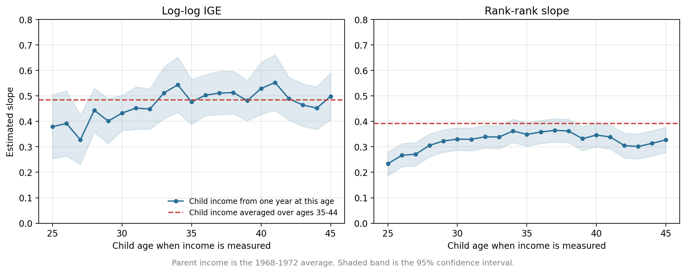
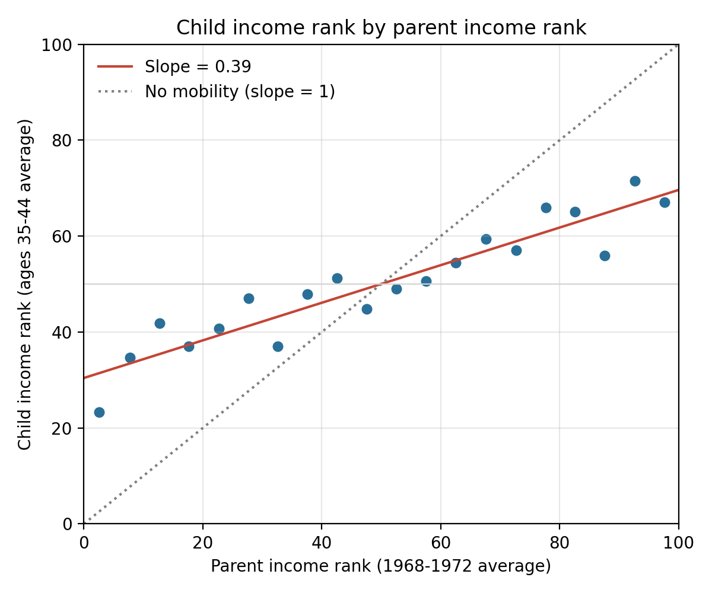

If your parents earn more than other parents, how much more will you earn as an adult? Economists answer this question with the intergenerational elasticity, or IGE. The idea is simple, but the data work is not. We need to follow the same families for decades, find out who is whose parent, and measure income for both generations. In this tutorial I show how to do all of this with SQL inside Python, using the Panel Study of Income Dynamics (PSID). Along the way, we will also see why the age at which we measure income can change the answer quite a lot.

The PSID started in 1968 with about 4,800 American families and has followed them and their children ever since. This makes it one of the few datasets where we can see a parent's income in the 1960s and the child's income forty years later. You only need basic Python and SQL to follow along. All code is in the [GitHub repository](https://github.com/xushiori-svg/psid-parent-child-sql), and every number below comes from the scripts there.

The first step is to download the data. The PSID is free, but you need to register an account at the [PSID Data Center](https://simba.isr.umich.edu/data/data.aspx). After logging in, open Variable Search, check the *PSID Family-level* and *PSID Individual-level* data types, click *Check all years*, and search by *Variable name*. We need only a few variables, but we need them for every year from 1968 to 2023. The repository has a file `data/psid_variables.csv` that lists the PSID name of each variable in each year, so you can paste them into the search box. I found it works better to paste about 40 names at a time. These are the variables:

- `ER30001` and `ER30002`: the 1968 interview number and the person number. Together they identify one person for life.
- For each year: the interview number of the person's family that year, the sequence number, the relation to the household head, and age.
- For each year: total family money income, which comes from the family file.

At checkout, choose *ASCII Data With Stata Statements* and *All Individuals*. You get a zip file with a large text file (my extract had 85,536 people) and a Stata do-file that tells you which columns hold which variable. Put it in `data/raw/`. The PSID does not allow us to share the data, so you need to download your own copy.

The most important thing to understand about the PSID is how people and families are identified. Every person has a fixed ID made from `ER30001 * 1000 + ER30002`. Families are different. Each year, every family gets a new interview number, and every person in that family carries that number for that year. So if a child and a father have the same interview number in 1970, they lived in the same family in 1970. The "relation to head" variable then tells us who is the head and who is the son or daughter. This is the key to the whole match.

The raw file is "wide": one row per person and one column per variable per year. SQL works much better with "long" tables, so the first script reshapes the data in pandas and saves three tables in a SQLite database.

```python
rows = []
for _, v in var_map.iterrows():
    one = pd.DataFrame({
        "pid": wide["pid"],
        "year": int(v["year"]),
        "family_id": wide[v["interview_no"]],
        "relation": wide[v["relation_to_head"]],
        "age": wide[v["age"]],
        "family_income": wide[v["family_income"]],
    })
    rows.append(one)
person_years = pd.concat(rows, ignore_index=True)
```

After a few cleaning steps (keeping people who actually lived in a PSID family that year, and recoding relation to head because the codes changed in 1983), we have `persons` with one row per person, `person_years` with 910,869 person-year rows, and `families` with 320,456 family-year rows. The `families` table is built in SQL with `GROUP BY`:

```sql
CREATE TABLE families AS
SELECT
    year,
    family_id,
    MAX(family_income) AS family_income,
    COUNT(*) AS family_size
FROM person_years
GROUP BY year, family_id;
```

`GROUP BY year, family_id` puts all people with the same family in the same year into one group, and the aggregation functions summarize each group. `COUNT(*)` counts the members, and `MAX(family_income)` simply picks the family income, which is the same for everyone in the family.

Now comes the main step, matching children to parents. We join the `person_years` table to itself. One copy plays the role of the child (`c`) and the other plays the parent (`p`). The `ON` condition says they must be in the same year and the same family, and the `WHERE` condition says `c` must be a son or daughter of the head and `p` must be the head.

```sql
CREATE TABLE parent_child AS
WITH pairs AS (
    SELECT
        c.pid AS child_id,
        p.pid AS parent_id,
        MIN(c.year - c.age) AS child_birth_year,
        COUNT(*) AS years_together
    FROM person_years AS c
    INNER JOIN person_years AS p
        ON c.year = p.year
        AND c.family_id = p.family_id
    WHERE c.role = 'child'
        AND p.role = 'head'
        AND c.year BETWEEN 1968 AND 1972
    GROUP BY c.pid, p.pid
),
one_parent AS (
    SELECT child_id
    FROM pairs
    GROUP BY child_id
    HAVING COUNT(*) = 1
)
SELECT pairs.*
FROM pairs
INNER JOIN one_parent
    ON pairs.child_id = one_parent.child_id
INNER JOIN persons AS s
    ON pairs.child_id = s.pid
WHERE s.id1968 < 3000
    AND pairs.child_birth_year BETWEEN 1952 AND 1968;
```

Let me go through the parts. The `INNER JOIN` keeps only rows where a child and a head share a family-year. Since a child appears in up to five years (1968–1972), the join gives one row per child, parent and year, so `GROUP BY c.pid, p.pid` collapses it to one row per pair, and `COUNT(*)` tells us how many years they lived together. Some children lived with two different heads, for example after a divorce. The second part, `one_parent`, uses `HAVING COUNT(*) = 1` to keep only children with a single head. `HAVING` is like `WHERE`, but it filters after the grouping. Finally, we keep children born 1952–1968 from the original national sample (1968 interview numbers below 3000), which means we can use the data without survey weights. The result is 3,098 children matched to 1,328 parents. In most families of this period the head is the father, so "parent" here mostly means the father, and income is the family's total income.

With the match in hand, building income measures is just more joins and aggregation. Prices and incomes grew a lot between 1968 and 2023, so I first divide each family's income by the average family income in the PSID that year. A value of 1.0 means an average family in that year, and 2.0 means twice the average. The parent table then uses `CASE WHEN` inside the aggregation to create a single-year measure and a five-year average in one query:

```sql
SELECT
    child_id,
    MAX(CASE WHEN year = 1968 THEN rel_income END) AS p_inc_1968,
    AVG(rel_income) AS p_inc_avg,
    COUNT(*) AS p_years
FROM parent_income_years
GROUP BY child_id;
```

`CASE WHEN year = 1968` keeps the 1968 value and returns `NULL` for the other years, and `MAX` ignores the `NULL`s. `AVG` averages all five years. The child side works the same way. I take the child's family income in each year when the child is the head or spouse of their own family, between ages 25 and 50, and compute the average over ages 35–44. Remember that the PSID asks about income in the previous year, so "1968" income is really income earned in 1967.

Now we can estimate the IGE. The classic version is a regression of log child income on log parent income:

$$\log(y_{child}) = \alpha + \beta \log(y_{parent}) + \varepsilon$$

The slope $\beta$ is the IGE. If $\beta = 0.5$, a child whose parents earned 10% more will earn about 5% more as an adult. A second version replaces income with percentile ranks. Each parent is ranked from 0 to 100 against the other parents, and each child against the other children:

$$rank_{child} = \alpha + \beta_1 \, rank_{parent} + \varepsilon$$

Here $\beta_1 = 0.3$ means that moving up 10 percentiles in the parent distribution moves the child up 3 percentiles. In Python, both are one line once the data is ready, using `np.log()` or `rank(pct=True)` and a small OLS function with robust standard errors.

The first lesson is about the parent side. The table below uses one common sample of 1,352 children who have income at age 27, at age 40, and for at least three years at ages 35–44, so every row uses the same people.

| Parent income | Child income | Log-log IGE | Rank-rank slope |
|:--|:--|:--:|:--:|
| 1968 only | Age 27 | 0.31 (0.05) | 0.27 (0.03) |
| 1968 only | Age 40 | 0.44 (0.06) | 0.33 (0.03) |
| 1968–1972 average | Age 27 | 0.35 (0.06) | 0.29 (0.03) |
| 1968–1972 average | Age 40 | 0.55 (0.06) | 0.35 (0.03) |
| 1968 only | Ages 35–44 average | 0.37 (0.04) | 0.36 (0.03) |
| 1968–1972 average | Ages 35–44 average | **0.48 (0.04)** | **0.39 (0.02)** |

: IGE estimates with different income measures. Robust standard errors in parentheses. N = 1,352 in every row. {.striped}

Look at the last two rows. With parent income from one year, the IGE is 0.37. With the five-year average, it rises to 0.48. The reason is that income in one year is a noisy measure of what a family really earns over time. A father may lose his job for a few months, get a bonus, or have a bad year in his business. These temporary ups and downs have nothing to do with the child's future, but they spread the parent incomes out, and the regression mistakes this noise for real differences. This is the classic measurement error problem, and it pushes the slope toward zero. Averaging five years cancels out much of the temporary noise, so what remains is closer to long-run economic status. A five-year average is still not perfect, so even 0.48 is probably a bit too low.

The second lesson is about the child side, and it is about age. The figure below estimates the IGE again and again, each time measuring the child's income at a different age, from 25 to 45. The parent measure is always the five-year average.

{width=100%}

At ages 25 to 27, the log-log IGE is only about 0.33 to 0.39. From the early 30s it moves up to around 0.45 to 0.55. This is called life-cycle bias. Children from richer families often stay in school longer, go to graduate school, or start in jobs that pay little at first but grow fast. At 25 their income looks quite similar to everyone else's, even though it will pull far ahead later. So if we measure child income too early, we see less connection to the parents than there really is. The same table shows this too: with the same parents and the same children, the IGE is 0.35 when the child is 27 and 0.55 when the child is 40.

The figure also shows a second problem with the log version. Even after age 30, the log-log IGE jumps around from one age to the next, and its confidence band is wide. Logs are very sensitive to small incomes. A family with $500 of income in a bad year has a log income far below everyone else, and a few such cases can pull the slope up or down. Ranks do not have this problem, because the lowest family is simply ranked near 0, no matter how low the dollar amount is. In the right panel, the rank-rank slope also starts low (0.23 at age 25), so ranks are not completely free of life-cycle bias. But it settles down by about age 30 and stays between 0.33 and 0.37 until the early 40s, with a much tighter confidence band. It dips a little after 42, when fewer children are observed at those ages. This is why recent studies, such as the work by Raj Chetty and coauthors on mobility in the United States, prefer the rank-rank slope. It gives a stable answer earlier in life and is not driven by a few extreme values.

So which measure should we trust? Averaging the child's income over ages 35–44 gives a log IGE of 0.48 and a rank-rank slope of 0.39 with our best parent measure, and these estimates have the smallest standard errors in the table. One year of income at age 40 gives a log IGE of 0.55, but one year at age 39 or 43 would give a different number. An average over ten years of the child's prime working age is less affected by the luck of one particular year, and it covers the part of life when income growth has mostly slowed down.

{width=80% fig-align="center"}

The last figure shows the final result in a picture. I split the parents into 20 equal groups by income rank and plot the average rank of their children. The points line up quite well along a straight line with a slope of 0.39. Children who grew up in the bottom 5% of families reach about the 23rd percentile on average, while children from the top groups reach about the 60th to 70th percentile. There is real mobility, since the line is much flatter than the "no mobility" line where every child ends up where their parents were. But family background still matters a lot.

This tutorial has some limits. I use family income, which includes the income of a spouse, so it measures the household's living standard more than one person's earnings. The parent is the household head, who is usually the father in these years. The sample is not large, and the children were born between 1952 and 1968, so the results describe a generation that grew up in the 1960s and 1970s. Finally, I do not use survey weights. Each of these choices is easy to change in the SQL files.

## Takeaway

SQL makes the hardest part of this analysis, finding each child's parent among almost a million person-year rows, a short and readable query: a self-join on year and family ID, a `GROUP BY`, and a `HAVING` filter. The results show that how we measure income matters as much as the method. Income from a single year makes families look more mobile than they are, both because one year is noisy for parents and because young adults have not reached their long-run income yet. Averaging income over several years and measuring children in their late 30s and early 40s gives a log IGE of about 0.48 and a rank-rank slope of about 0.39. The rank-rank slope is also more stable across ages, which makes it a safer choice when we cannot follow children for many years.

---

*Data: Panel Study of Income Dynamics, public use dataset, 1968–2023, produced and distributed by the Survey Research Center, Institute for Social Research, University of Michigan. Variables: 1968 interview number and person number (ER30001, ER30002), sex (ER32000), and for each wave the interview number, sequence number, relation to head, age, and total family money income. Sample: children of the household head in 1968–1972, born 1952–1968, from the SRC core sample; children who lived with more than one head are dropped. Income in each year is divided by the average PSID family income in that year. Parent income uses the 1968–1972 waves (at least 3 years). Child income is family income when the child is head or spouse, at ages 25–50. Ranks are computed within the regression sample. Robust (HC1) standard errors, no survey weights. Code is available on [GitHub](https://github.com/xushiori-svg/psid-parent-child-sql).*
