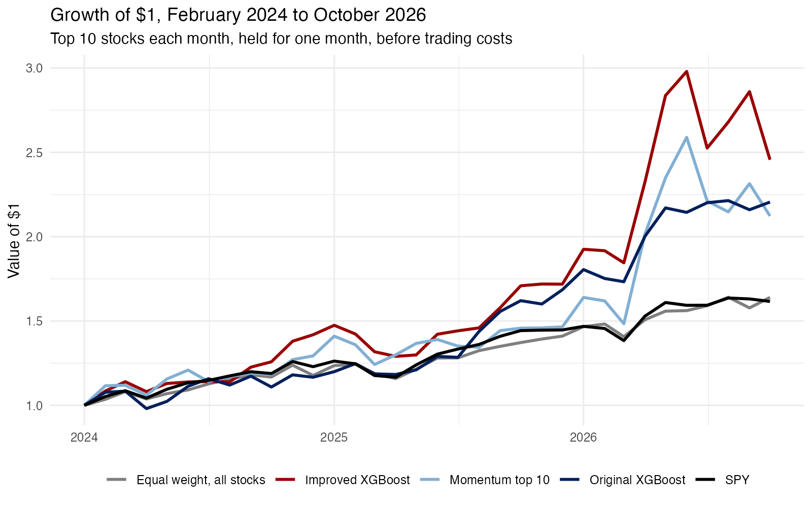
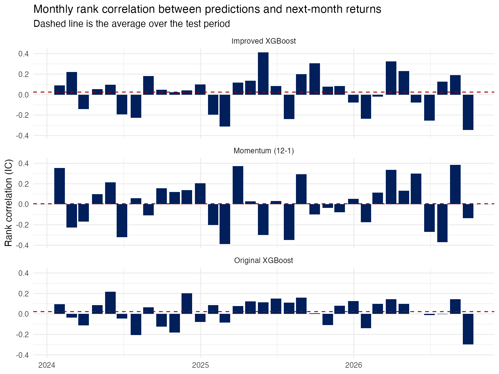

AI is everywhere now, and we use it for almost everything, from booking flights to finding hotels. Using machine learning to pick stocks is not new, and many investment firms have done it for years. This time I wanted to test it myself. Does picking stocks with XGBoost really earn more than simple ways of picking stocks?

I started with an original XGBoost model. XGBoost is a gradient boosting method. It starts with a simple prediction and then adds small decision trees one by one, and each new tree tries to fix the errors left by the earlier ones. The model uses daily prices of 95 large U.S. companies since 2022. Based on each stock's recent price changes, volatility and performance relative to the market, it predicts the stock's return over the next month or so. Each month, it buys the 10 stocks with the highest predicted returns, holds them for a month, and then chooses again.

Predicting stock returns is hard for three reasons. First, if a pattern works for a long time, rational investors will find it and use it, and the extra profit will slowly disappear. Second, there is very little data to test with. Looking at monthly returns, three years give us only 36 observations. Finally, a high return does not mean that a model is good at picking stocks. Part of a stock's return comes from how its whole industry is doing, and only part comes from the company itself. A model may earn a lot just because one industry did very well, or because it picked very risky stocks that happened to go up. Investors often talk about an "impossible triangle", since it is hard to get high returns, low risk and high liquidity at the same time. So when we look at how much a strategy earned, we also need to look at how much risk it took.

I changed four parts of the original model: the signals it uses, the prediction target, the training period and the model settings. First, I kept only signals based on returns and added the past 12-month return, the distance from the 52-week high and the change in trading volume. Second, each month I turned these signals into each stock's rank among the 95 stocks, and the model predicts next month's return rank. This makes data from different years easier to compare. Third, the training data start in 2015, and the model is retrained every year with all earlier data. Finally, I used data from 2023 to choose the best of four sets of settings.

To judge whether the models can really pick stocks, I compared them with three simple strategies. The first is a momentum strategy, which each month simply buys the 10 stocks that rose the most over the past year. If a complex model cannot beat this one simple rule, the extra complexity adds little. The second is buying all 95 stocks in equal amounts. These are today's large companies, so a model needs to beat "buying everything" to show that it picked the right stocks within this group. The third is SPY, which follows the whole market. The test period runs from February 2024 to October 2026, 33 months in total, and every strategy rebalances once a month.

{width=100%}

Looking only at returns, both XGBoost models won. The improved model earned the most, and the original model and the momentum strategy came close behind. All three ended far above equal weighting and SPY, with total gains roughly twice as large. Trading costs did not change this ranking.

| Strategy | Annual return | After trading costs | Volatility | Sharpe ratio |
|:--|--:|--:|--:|--:|
| Improved XGBoost | 38.7% | 37.1% | 28.6% | 1.29 |
| Original XGBoost | 33.3% | 31.4% | 18.4% | 1.67 |
| Momentum top 10 | 31.5% | 30.6% | 31.5% | 1.02 |
| Equal weight, all 95 stocks | 19.7% | 19.7% | 11.3% | 1.66 |
| SPY | 19.1% | 19.0% | 11.9% | 1.53 |

: Performance from February 2024 to October 2026. Trading costs are 0.1% of each trade. {.striped}

Returns are not the whole story, though, and the recent market drop reminded me how painful losses can be. The improved model moved up and down much more than the other strategies. It most often picked MU, AMD, AVGO, NVDA and TSLA, which happened to ride a strong rally in chip stocks. When the market rose, it rose more than the market, and when the market fell, it fell the most, as the last few months of the figure show. After adjusting for risk, neither model did clearly better than buying all 95 stocks equally, and once we remove the market's own movement, their extra returns cannot be told apart from luck.

{width=100%}

Another way to check the models is to see how well the predicted ranking matches the actual ranking of returns, which is called the information coefficient (IC). The average IC of all three is very close to zero, and it switches between positive and negative from month to month with no stable direction. The improved model looked better during the 2023 validation period than in the test period, so a pattern that works in one period may not work in the next.

## Takeaway

I changed the model's signals, prediction target, training period and settings. The improved model predicted slightly better than the original model and the simple momentum strategy, but the predictive power of all three is very close to zero. As an investment, the improved model earned the most, even after trading costs, but most of its return came from holding very volatile chip stocks, and after adjusting for risk it did not beat buying all 95 stocks equally. The more complex model did not really learn to predict stock returns, which itself shows how hard this task is.

---

*Data: daily adjusted prices for 95 large U.S. stocks and SPY from Yahoo Finance, January 2014 to October 2026, downloaded with the tidyquant package. The original model is trained on 2022–2023 and tested from 2024. The improved model is trained from 2015 and retrained each year. All strategies are formed on the last trading day of each month and held for one month. Sharpe ratios are annualized from monthly returns without subtracting a risk-free rate. Code is available on [GitHub](https://github.com/xushiori-svg/stock-xgboost).*
